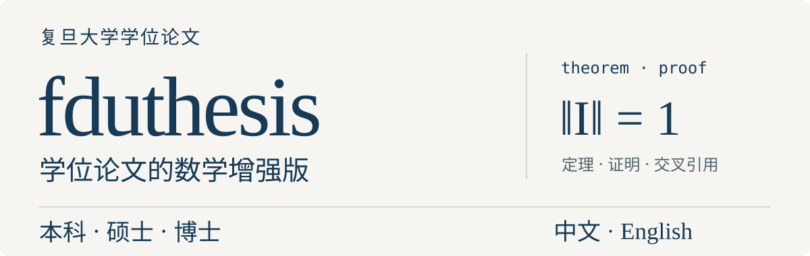

# fduthesis

<p align="center">
  
</p>

fduthesis 提供复旦大学本科、硕士与博士论文的中文、英文文档类。本仓库维护中文数学增强实现，保留定理环境、交叉引用与 `style/spec = 2026` 配置；校徽、校名和引用样式随仓库提供，可以独立使用。

[快速开始](#快速开始) · [数学排版](#数学排版) · [源码与检查](#源码与检查) · [许可证与来源](#许可证与来源)

| 使用入口 | 内容 |
| --- | --- |
| [论文模板](templates/main.tex) | 封面信息、摘要、正文与参考文献的完整示例 |
| [2026 年规范配置](docs/2026-论文规范适配开发文档.md) | 封面、字体、版心和引用样式的适配说明及边界 |
| `fduthesis` / `fduthesis-en` | 中文与英文文档类 |

## 快速开始

环境需要支持中文的 TeX 发行版，以及 XeLaTeX 和 `latexmk`。完整示例使用 BibTeX 处理参考文献；切换到 `biblatex` 后需要 Biber。

在 macOS 或 Linux 的终端执行：

```sh
git clone https://github.com/xkwxdyy/fduthesis.git
cd fduthesis
sh install-unix.sh
```

安装脚本在 `thesis/` 内准备可编辑的示例、运行文件、校徽和引用样式。Windows 环境可运行 [install-win.bat](install-win.bat)。

首次编译前，应在 `thesis/main.tex` 的 `\fdusetup` 中核对字体。原模板使用 `font = times*` 与 `cjk-font = mac`；需要使用 TeX 发行版随附字体时，可将对应选项改为：

```tex
style = {
  spec = 2026,
  font = lm,
  cjk-font = fandol,
  % 保留其余样式选项。
},
```

Fandol 与 Latin Modern 适合验证独立编译，字形与原模板的 Times New Roman、macOS 中文字体存在差异。正式论文应按实际系统字体和院系要求选择配置；Windows 中文字体选项为 `cjk-font = windows`。

完成字体配置后，在同一终端执行：

```sh
cd thesis
latexmk -xelatex main.tex
```

结果为 `thesis/main.pdf`。正文、论文类型与身份字段均在 `thesis/main.tex` 中填写，参考文献数据位于 `thesis/main.bib`。论文类型通过文档类选项 `type = bachelor`、`master` 或 `doctor` 选择。

## 数学排版

中文类提供定理与证明环境。以下片段可以放入论文正文，定理标签可通过 `\cref` 引用：

```tex
\begin{theorem}\label{thm:identity}
  非零赋范空间上恒等算子的范数等于一。
\end{theorem}
\begin{proof}
  对任意非零向量 $x$，都有 $\lVert Ix\rVert/\lVert x\rVert=1$。
\end{proof}
由\cref{thm:identity}可得上述结论。
```

参考文献后端、数学计数器和样式配置应与所选模板保持一致，具体配置可参照 [完整模板](templates/main.tex) 与 [独立检查](tests/check-standalone.py)。

## 源码与检查

| 维护文件 | 用途 |
| --- | --- |
| [source/fduthesis-math.dtx](source/fduthesis-math.dtx) | 中文数学增强类的维护源码 |
| [source/fduthesis.dtx](source/fduthesis.dtx) | 生成入口、英文类和定义文件 |
| 根目录的 `.cls`、`.def`、`fdulogo.sty` | 随仓库提供的运行文件 |

重新生成运行文件可使用 `l3build unpack`。生成一致性、数学定理、交叉引用和 2026 年引用样式检查使用：

```sh
python3 tests/check-standalone.py
```

该检查需要 Python 3、`l3build`、XeLaTeX 与 Biber，并在独立临时目录中验证编译。

<details>
<summary>在集成仓库中维护</summary>

本项目由独立仓库 `xkwxdyy/fduthesis` 维护，`fduTeX` 通过 Git 子模块记录版本。首次维护子模块时应确认当前分支为 `main`；子项目独立提交、推送后，根仓库再更新版本记录。

公开仓库仅维护通用源码、模板、文档与必要资源，个人材料和编译产物保留在本地。

</details>

## 许可证与来源

本项目基于 Xiangdong Zeng 的 fduthesis，保留上游版权与维护声明。许可条款见 [LICENSE](LICENSE) 及相应源文件。正式提交论文前，应核对院系当前的格式与材料要求。
